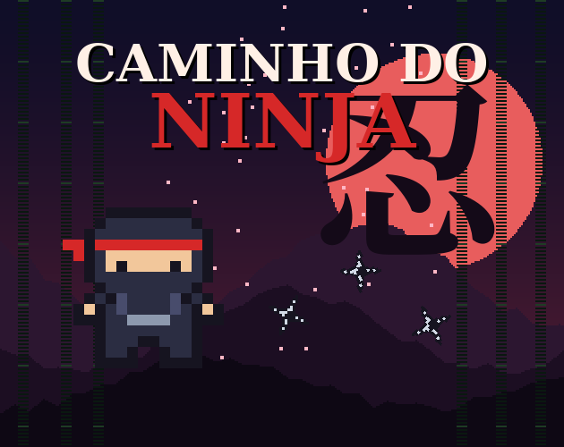

# Caminho do Ninja

Jogo 2D feito em Unity 6 para o **Projeto Introdução ao Unity (Tutorial)** da disciplina Jogos Digitais 2025.2, Insper.

**Aluno(a):** Matheus Constante Simoes de Campos
**Jogue no navegador (itch.io):** https://matheusconst13.itch.io/caminho-do-ninja

## O jogo

Você é um ninja dentro de um dojo e precisa recolher as **10 shurikens** antes que o **cronômetro chegue a zero**.
Samurais patrulham o dojo, um ninja sombra persegue quem entra na área dele e há estrepes (makibishi) espalhadas pelo chão.
Ampulhetas dão mais tempo, e o tempo que sobra no final vira bônus de pontos.

## Controles

| Ação | Teclado | Controle (Xbox) |
|---|---|---|
| Mover | WASD ou setas | Analógico esquerdo ou direcional |
| Dash (invulnerável, gasta stamina) | Espaço ou Shift | A ou RT |
| Pausar | Esc ou P | Start |
| Navegar nos menus | Setas + Enter, ou mouse | Direcional/analógico + A |

## Regras

- 3 vidas. Encostar em um samurai, no ninja sombra ou nas estrepes tira 1 vida, empurra o ninja e dá 1,2 s de invencibilidade.
- O dash deixa o ninja invulnerável por um instante e gasta 35 de stamina. A stamina recarrega sozinha.
- O cronômetro começa em 1:30. Cada ampulheta dá +10 s. Nos últimos 10 s o relógio fica vermelho e faz tique-taque.
- Cada shuriken vale 100 pontos. Ao vencer, cada segundo que sobrou vale +10 pontos.
- A partida acaba quando você recolhe todas as shurikens (vitória), perde as 3 vidas ou o tempo acaba. Em todos os casos aparece a tela de fim com o tempo da missão, a pontuação e as opções **Jogar novamente** e **Menu**. Com a pausa também dá para reiniciar ou voltar ao menu a qualquer momento, então não existe dead-end.

## O que foi feito (rubrica)

| Item | Onde está no jogo |
|---|---|
| 1. Tutorial | Base do tutorial "Introdução Rápida": Rigidbody 2D, colliders, triggers, tags, prefabs, áudio, movimentação diagonal normalizada, menu inicial e GameManager estático |
| 2.1 Mecânica de tempo | Cronômetro regressivo no HUD; tempo final na tela de fim; o tempo é uma mecânica (acabar = derrota, ampulhetas dão +10 s, sobra vira bônus, alerta nos últimos 10 s) |
| 2.2 Inimigos | Samurais com patrulha em direção pré-determinada (`InimigoPatrulha`); ninja sombra que patrulha e muda para perseguição quando o jogador entra no raio de detecção (`InimigoPerseguidor`); estrepes paradas que causam dano |
| 2.3 Visual | Sprites básicos com cor trocada (área de detecção roxa, mancha de perigo vermelha das estrepes, barra de stamina); sprites em pixel art no tema ninja (ninja, samurai, ninja sombra, shuriken, ampulheta, estrepes, tatame, madeira, corações, fundo do menu) |
| 2.4 Áudio | Música no menu e na partida; efeitos de shuriken, ampulheta, dash, dano, alerta do ninja sombra, tique-taque do tempo, clique, vitória e derrota |
| 2.5 UI | HUD com pontos, shurikens, tempo atual, vidas (corações) e barra de stamina |
| 2.6 Controles | Suporte a controle de Xbox pelo Input System (movimento, dash, pausa e navegação nos menus) |
| 2.7 Level design | Tema ninja; arena nova (dojo com tatame, paredes e caixas como obstáculos); novos desafios (inimigos, armadilhas, limite de tempo, dash com stamina) |
| Menu inicial | Menu no tema do jogo com Jogar, Como jogar e Sair (o Sair fica escondido no WebGL) |
| WebGL | Build WebGL publicado no itch.io |

## Estrutura do projeto

- `Assets/Scripts/`: código do jogo (`PlayerMovement`, `PlayerHealth`, `GameManager`, `InimigoPatrulha`, `InimigoPerseguidor`, `MenuInicial`, `AnimacaoSprite`, `Girar`)
- `Assets/Editor/NinjaBuilder.cs`: monta as cenas, os prefabs e a UI (menu **Ninja > Montar cenas**) e gera o build (**Ninja > Build WebGL**). Rodar "Montar cenas" recria as cenas do zero.
- `Assets/Tests/`: testes automáticos de Play Mode (vitória, derrota por vida e por tempo, ampulheta, pausa, inimigos e menu)
- `Tools/gerar_assets.py`: script Python que gera todos os sprites, a música e os efeitos sonoros
- `Docs/`: capa e screenshot para a página do itch.io

Versão do Unity: **6000.6.6f1** (Unity 6.6), template Universal 2D (URP).

## Créditos e referências

- Tutorial base: "Tutorial: Introdução Rápida", Jogos Digitais Insper (Profs. Tiago Sanches e Gustavo Braga, Tec. Pedro Emil).
- Sprites, músicas e efeitos sonoros: originais, gerados por código em `Tools/gerar_assets.py` para este projeto (pixel art desenhada em texto e síntese de áudio com numpy). Não foram usados assets de terceiros.
- Fontes: interface com a fonte padrão do Unity (LegacyRuntime). A imagem de capa usa DejaVu Serif e Noto Serif CJK (licenças livres) só para o título e o kanji 忍 ("ninja").
- Pacotes Unity: Universal Render Pipeline, Input System e uGUI.
